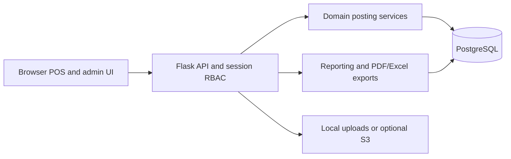
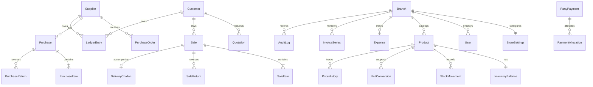

# Architecture and data model

## Components

The browser is a thin client. It may preview a cart, but the server recalculates every price, discount and GST component before posting. PostgreSQL is the intended production database; SQLite is used for isolated local tests.

## Main entities

The full column definitions and constraints are in `models.py`. Monetary values use SQL `NUMERIC`, never binary floats. Stock quantities have six decimal places. Document lines copy the relevant product code, description, rates, conversion, tax split and cost at posting.

## Posting invariants

1. A purchase order, purchase draft, quotation or held bill leaves stock and ledgers untouched.
2. Confirming a purchase locks its document and inventory balance rows, increases base-unit stock, updates weighted average cost, writes a movement and supplier payable, then commits as one transaction.
3. Checkout checks authorization, credit and stock limits; locks inventory balances; allocates a financial-year number; freezes tax and cost on each line; decreases stock; posts movements, payment records and customer ledger entries; then commits as one transaction. A unique idempotency key prevents a repeated checkout from posting twice.
4. Returns use separate, consecutively numbered documents linked to the original. Sale returns restore stock at the **original sale cost**. Purchase returns remove stock at the **current weighted average cost** while the supplier credit uses the original purchase price. Returns and payments are posted to the corresponding party ledger.
5. Invoice numbers never reset within the financial year and remain reserved after cancellation. PostgreSQL advisory transaction locks and row locks serialize number allocation; unique constraints are a second guard.
6. Direct customer and supplier payments reduce the party ledger and allocate to open invoices oldest first, unless a specific document is requested. Opening balances remain separate immutable starting amounts.
7. Sensitive changes append audit entries. Stock movements, party ledger entries and audit entries reject ORM updates/deletes; corrections post new reversal records.

## Cost example

If the store has 10 pieces at ₹8 and receives 10 pieces at ₹12, the weighted average becomes ₹10. A sale of 3 pieces snapshots ₹30 COGS. Editing today's product purchase price to ₹15 changes neither that sale nor its gross profit. A verified return of one sold piece restores stock at the original ₹10 cost.

## GST decisions

The store records whether it is GST registered, its GSTIN and state code. The POS requires an explicit place of supply for out-of-state customers. Product/HSN tax rates can be effective dated, and the posted line stores the actual rate plus CGST, SGST or IGST amounts. A taxable tax invoice cannot post without HSN. Bill of Supply is restricted to zero-tax lines. Registered stores cannot label taxable sales as non-GST retail bills. GSTR worksheets are preparation data only.

## Expansion and operations

All principal business rows carry `branch_id`; balances and invoice sequences are per branch. The current interface serves one `MAIN` branch. Before scaling to many branches, add branch selection, stock transfers, schema migrations, indexed server-side report aggregation, PostgreSQL concurrency/load tests, and tested backup automation. The IRP e-invoice flow needs an authorized integration before use by businesses to which it applies.
